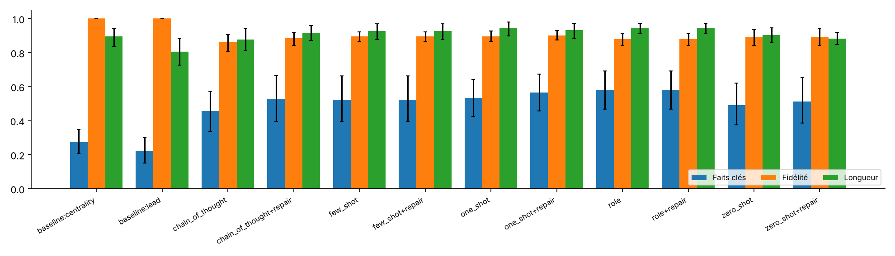

# PromptLab


> **Résumé contrôlé de documents techniques par LLM.** Cinq techniques de prompting, une boucle de vérification-réparation sur la sortie du modèle, et un banc d'évaluation reproductible (baselines extractives, métriques de fidélité, intervalles de confiance bootstrap, comparaisons appariées). Interface Qt, CLI, tests et CI.

<p align="center">
  
</p>

---

## ✨ Ce que ça fait

```text
document (txt / docx / pdf)
   │
   ▼
technique de prompting ──► LLM local (Ollama) ──► nettoyage ──► vérifications ──OK──► résumé
(zero-shot · one-shot ·                                          │  longueur ± 15 %
 few-shot · chain-of-thought ·                                   │  un seul paragraphe
 role prompting)                                                 │  aucun nombre inventé
                                                                 │  phrase complète
                                                    échec ◄──────┘
                                                      │  retour précis au modèle
                                                      ▼  («81 mots au lieu de 50», «8080 absent du texte»)
                                                   nouvelle tentative (max 3) ──► sinon troncature propre
```

La sortie du LLM est traitée comme celle d'un composant logiciel : elle passe des **assertions**. Quand une vérification échoue, le modèle reçoit le défaut exact plutôt qu'une simple relance générique.

---

## 📊 Résultats (qwen2.5:3b local, Ollama, CPU)

| Système | Faits clés | ROUGE-L | Fidélité | Respect longueur | Nombres inventés |
|---|---|---|---|---|---|
| `baseline:lead` | 22 % [15–30] | 26 % | 100 % | 81 % | 0 |
| `baseline:centrality` | 28 % [21–35] | 20 % | 100 % | 89 % | 0 |
| `zero_shot+repair` | 51 % [39–65] | 33 % | 89 % | 88 % | 0 |
| `few_shot+repair` | 52 % [40–66] | 35 % | 89 % | 93 % | 0 |
| `chain_of_thought+repair` | 53 % [40–67] | 36 % | 88 % | 92 % | 0 |
| `one_shot+repair` | 57 % [46–67] | 36 % | 90 % | 93 % | 0 |
| **`role+repair`** | **58 % [47–69]** | 36 % | 88 % | **94 %** | 0 |

**IC 95 % par bootstrap · comparaisons appariées · 0 nombre inventé sur 120 résumés.**

Tableau complet (12 systèmes) : [`results/RESULTS.md`](results/RESULTS.md) · données brutes : [`results/runs.csv`](results/runs.csv)

---

## 🛠️ Stack

| Composant | Technologie |
|---|---|
| LLM local | Ollama (`qwen2.5:3b`) |
| API alternative | Compatible OpenAI |
| Interface graphique | PySide6 (Qt 6) |
| Métriques | ROUGE-L, faits clés, fidélité lexicale |
| Statistiques | Bootstrap, comparaisons appariées |
| Tests | pytest · pytest-qt |
| CI | GitHub Actions (replay sans GPU) |

---

## 🚀 Installation et utilisation

```bash
pip install -e ".[dev]"

# Interface graphique Qt
promptlab gui

# Résumer un document
promptlab summarize rapport.pdf -t few_shot -n 60

# Lancer le banc d'évaluation complet
promptlab bench --model ollama:qwen2.5:3b --cache results/llm_cache.json --lengths 30 60 --seeds 1

# Rejouer sans GPU (identique à la CI)
promptlab bench --model replay:ollama:qwen2.5:3b --cache results/llm_cache.json --lengths 30 60 --seeds 1

# Tests unitaires
pytest -q
```

---

## 🏗️ Architecture du code

| Module | Rôle |
|---|---|
| `techniques.py` | 5 techniques de prompting ; exemples few-shot hors corpus |
| `llm.py` | Client Ollama / OpenAI-compatible, replay, cache |
| `summarizer.py` | Nettoyage, vérifications, prompt de réparation, troncature |
| `metrics.py` | Longueur, ROUGE-L, faits clés, fidélité, nombres inventés |
| `stats.py` | IC bootstrap, bootstrap apparié |
| `baselines.py` | `lead` et `centrality` (graphe de similarité TextRank) |
| `bench.py` | Plan d'expérience, agrégation, rapport Markdown/CSV/graphique |
| `gui.py` / `cli.py` | Interface Qt et ligne de commande |

---

## 🔬 Évaluation

**Corpus :** 6 textes techniques (NoC, AXI, OSPF, CI, MQTT, RAG) · **Plan :** systèmes × documents × longueurs (30 et 60 mots) × graines · **Reproductibilité :** chaque réponse LLM est mise en cache, le banc se rejoue sans GPU en CI.

**Ce que montrent les chiffres :**

- Le LLM **double la couverture des faits essentiels** (≈ 50–58 % vs 22–28 % pour l'extractif), sans inventer de nombres.
- Le role prompting arrive en tête, mais les **écarts entre techniques ne sont pas significatifs** sur 6 documents (IC 95 % chevauchants) ; conclure demande un corpus plus large.
- La **boucle de réparation** aide surtout les techniques instables (chain-of-thought : 67 → 83 % de résumés conformes).
- **Le banc a détecté un bug dans mon propre code** : la boucle *dégradait* la longueur sur les petits modèles. Corrigé et couvert par un test de non-régression, sans aucun nouvel appel LLM grâce au cache.

---

## Contexte

Refonte personnelle d'un projet académique réalisé en équipe de trois à l'ENSA Fès (2025–2026, encadré par Pr. Safae Sossi-Alaoui). La v1 comparait cinq techniques sur le respect de la longueur ; cette v2 vise une **évaluation rigoureuse** : qualité (faits essentiels, fidélité), comparaisons à des baselines sans LLM, intervalles de confiance.

---

## Limites

- Fidélité mesurée lexicalement : une paraphrase correcte peut être pénalisée. Un juge NLI serait l'étape suivante.
- 6 documents et 1 graine : suffisant pour comparer avec IC, pas pour conclure en général. Corpus extensible (`data/`), banc multi-graines (`--seeds`).

---

*Python 3.10+ · Ollama · PySide6 · pytest · pytest-qt · matplotlib · GitHub Actions*
